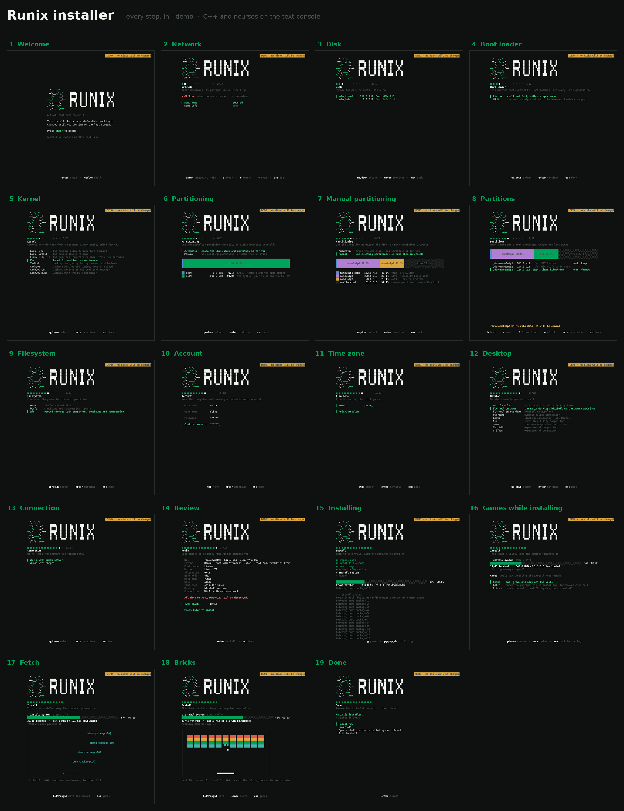

# Runix

A NixOS that runs on Runit.
Docs are in progress.

Runix is also the Linux distribution you can play games in while it installs:
Snake, Fetch and Bricks, right in the installer, tied to the packages Nix is
downloading. See [Games while you install](#games-while-you-install).

# Warning
Just in case it isn't obvious, Runix is a very new project, so test it in a VM.

## Binary cache

CI-built Runix artifacts and patched desktop packages are available from the
public `runix-community` Cachix cache. Configure it in `flake.nix` with
`nixConfig`:

```nix
{
  nixConfig = {
    extra-substituters = [ "https://runix-community.cachix.org" ];
    extra-trusted-public-keys = [
      "runix-community.cachix.org-1:sENfG2mPWobsz1MKahUs+HOGfVt2L3OvG5oHHD5/coE="
    ];
  };

  # inputs and outputs...
}
```

Then allow the flake-provided cache configuration when building:

```sh
nix build --accept-flake-config .#vm
```

## Installing from an ISO

Build the live ISO on an x86_64 machine with `runixisogen`:

```sh
nix run --accept-flake-config github:runix-community/runix#runixisogen
```

Run it inside a Runix checkout to build that checkout, or pass
`--flake PATH#HOST` to build a host that sets `runix.iso.enable = true`. The
image boots on BIOS and UEFI machines from a CD or a USB drive. It is about
500 MB: it carries firmware for Wi-Fi and wired network cards and for AMD and
Intel graphics, one locale, and an xz-compressed store. Set
`runix.iso.firmware = "full"` for all of linux-firmware, or
`runix.iso.compression = "zstd"` for a larger image that starts programs faster.

The installer is a full-screen ncurses app written in C++. It starts on tty1
at boot, and tty2 has a root shell. Run `runix-installer --demo` to try the
interface without changing anything. It can erase the whole selected disk
(a 1 GiB FAT boot partition with an ext4, Btrfs or ZFS root), or install to
partitions you pick or create in `cfdisk`, keeping an existing EFI system
partition. It writes a flake to `/etc/runix` and installs Limine or GRUB. While
installing, it reads Nix's `--log-format internal-json` output to show how many
packages are built and fetched and how much has been downloaded. Installing
needs internet access because it downloads Runix and its packages. Wired
networks connect automatically, and the installer can join Wi-Fi through
`runix-network`. A Wi-Fi network joined there is kept on the installed system.
When it finishes, it can open a shell inside the installed system.
If an installation fails, it offers to upload the log, with host and user
names replaced, so it can be linked from a GitHub issue. Uploads go to
paste.rs unless `runix.iso.logPasteUrl` names another service.



### Games while you install

Downloading a system takes a while, so the installer has a small game hub.
Press `g` on the install screen and pick one:

| Game | What it is |
|---|---|
| Snake | Eat, grow, stay off the walls. Every package Nix finishes drops a pellet. |
| Fetch | Catch the packages Nix is installing as they fall, by their real names. Red ones are broken: `[hash mismatch]`, `[corrupt nar]`. Let those fall. |
| Bricks | Break the wall. The ball and the debris of broken bricks run on a small 2D XPBD physics solver; catch the debris for extra points. |

The install never waits on a game: its progress stays on screen above the
board, a failure takes over at once, and when it finishes the game pauses with
"Runix is installed · press Enter". It all runs on the text console, so it
works over a serial line too. Try it without installing anything:
`runix-installer --demo`, then `g` once the install step starts.

Games during a long wait are not new: video games have had playable loading
screens since the 1980s. In an operating system installer they are rare. In
2004 someone asked Fedora for
[small games during installation](https://bugzilla.redhat.com/show_bug.cgi?id=115644),
and the request was closed as WONTFIX, the reasoning being that an OS
installation is not a gaming console. Runix respectfully disagrees.

## Package channel

Runix includes [runixpkgs](https://github.com/runix-community/runixpkgs) by
default. Its packages are available as `pkgs.zwwm`, `pkgs.shojiwm` and
`pkgs.driftwm` in `runix.lib.runixSystem` modules. Add the window managers you
want to the system environment:

```nix
runix.lib.runixSystem {
  system = "x86_64-linux";
  modules = [
    ({ pkgs, ... }: {
      runix.packages = [ pkgs.zwwm pkgs.driftwm ];
    })
  ];
}
```

The same packages are available as `runix.packages.${system}.{zwwm,shojiwm,driftwm}`.
For a custom nixpkgs instance, use `runix.overlays.default`; the preconfigured
package set is also available through `runix.lib.mkPkgs system`. Upstream
sources and Nixpkgs revisions are pinned in the flake lock.

Window managers can also be enabled with `programs` options:

```nix
programs.zwwm.enable = true;
programs.shojiwm.enable = true;
programs.driftwm.enable = true;
```

Each has a `package` option, for example
`programs.zwwm.package = pkgs.zwwm.override { xwaylandSupport = false; };`.
When `runix.desktop.enable = true`, enabled Wayland sessions appear in SDDM.
To use only another compositor, set `programs.hyprland.enable = false`.

## Services from other flakes

Any flake can add runit services, or other settings, to Runix systems by
exporting a module as `runixModules.<name>`. Start one from the template:

```sh
nix flake init -t github:runix-community/runix#service
```

The module defines its own options and turns them into `runix.services`
entries. That option takes a `command` or `script`, plus `user`, `group`,
`environment`, `path`, `after`, `check`, `restart` and `log`:

```nix
# module.nix in the service's flake
{ config, lib, pkgs, ... }:
{
  options.services.hello.enable = lib.mkEnableOption "the hello service";
  config = lib.mkIf config.services.hello.enable {
    runix.services.hello.command = "${pkgs.hello}/bin/hello --greeting=hi";
  };
}
```

A Runix flake then adds that flake as an input and imports the module:

```nix
{
  inputs.runix.url = "github:runix-community/runix";
  inputs.hello.url = "github:someone/hello-runix";

  outputs = { runix, hello, ... }: {
    runixConfigurations.machine = runix.lib.runixSystem {
      system = "x86_64-linux";
      modules = [
        hello.runixModules.default
        { services.hello.enable = true; }
        ./configuration.nix
      ];
    };
  };
}
```

The module gets `pkgs` from the system that imports it, so the service flake
does not need its own nixpkgs input. To use packages the flake builds itself,
export `runixModules.default = import ./module.nix self;` and read them from
`self.packages.${pkgs.stdenv.hostPlatform.system}` inside the module.

## Networking

`dhcpcd` is currently the recommended network configuration service:

```nix
runix.systemServices.dhcpcd.enable = true;
```

Do not enable `dhcpcd` and NetworkManager at the same time, as both services
would attempt to configure the same network interfaces.

# Credits
- [finix-project](https://github.com/finix-community/finix.git) provides very useful, helpful anti-systemd patches for some components.

## License

Runix is licensed under the BSD 3-Clause License. See [LICENSE](LICENSE).
Runit retains its upstream BSD-style license.
